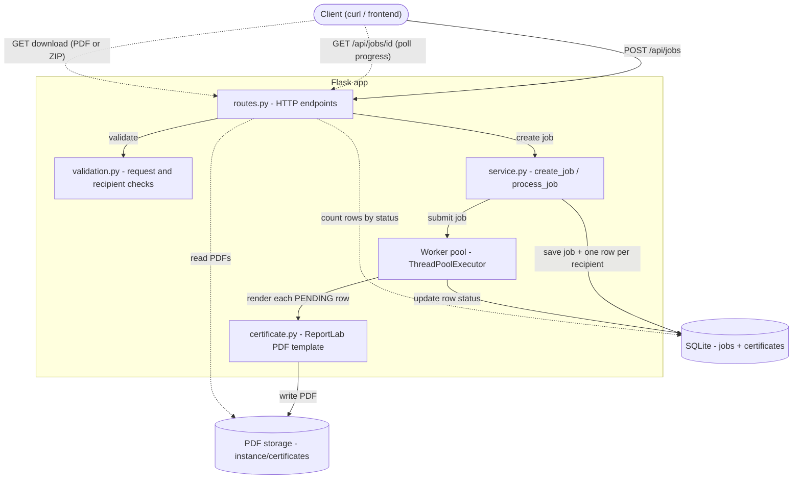
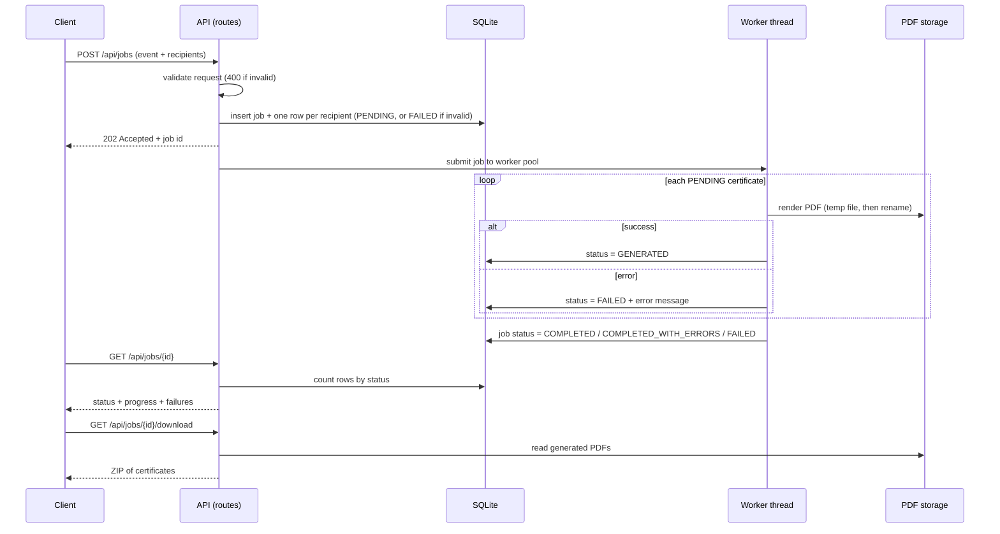
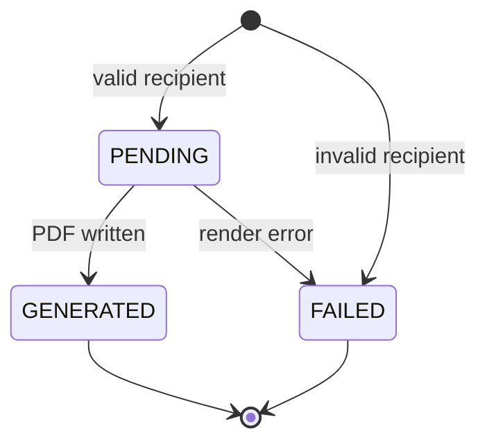
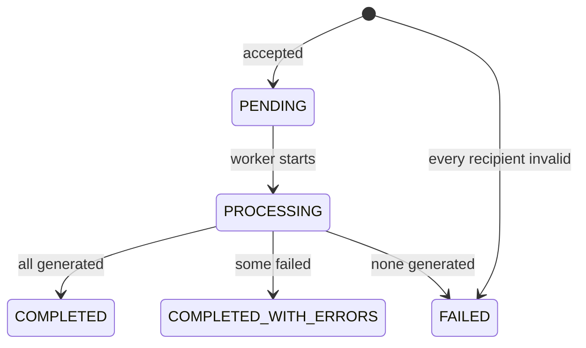

# Bulk Certificate Generator

A backend API that accepts a list of recipients in **one request**, generates a PDF
certificate for every valid recipient from a single predefined template, tracks
progress, and lets the client retrieve the results.

* **Stack:** Python 3.10+, Flask, SQLite (relational DB, via stdlib `sqlite3`), ReportLab (PDF)
* **Processing:** background worker threads (job is accepted immediately, client polls)
* **Tests:** 44 tests (`unittest`-style, also run by `pytest`)

## Setup

```bash
python -m venv .venv
source .venv/bin/activate          # Windows: .venv\Scripts\activate
pip install -r requirements.txt    # add requirements-dev.txt if you want pytest
```

## Run

```bash
python run.py                      # http://127.0.0.1:5000
```

The SQLite database and generated PDFs are stored under `instance/` (created
automatically). Configuration via environment variables:

| Variable | Default | Meaning |
|---|---|---|
| `CERTGEN_DB` | `instance/certgen.db` | SQLite file |
| `CERTGEN_STORAGE` | `instance/certificates` | Where PDFs are written |
| `CERTGEN_MODE` | `background` | `background` (202 + poll) or `sync` (generate before responding) |
| `CERTGEN_WORKERS` | `2` | Worker threads (jobs processed in parallel) |
| `CERTGEN_MAX_RECIPIENTS` | `5000` | Max recipients per request |

> `run.py` uses Flask's development server. For production use a WSGI server, e.g.
> `gunicorn -w 1 --threads 4 run:app` (see *Design decisions* for why one process).

## Run the tests

```bash
python -m unittest discover -s . -t . -v     # no extra dependencies
# or
pip install -r requirements-dev.txt && pytest
```

Tests cover: creating a job, request- and recipient-level validation, PDF
generation (content is checked, not just file existence), job status/progress
(observed *while* a job is running), failure of an individual certificate,
retrieval (single PDF, ZIP, filters, pagination, error cases), background mode,
and resuming an interrupted job after a restart.

## API

All bodies are JSON; errors always look like
`{"error": {"code": "...", "message": "...", "details": [...]}}`.

### 1. Submit a generation request — `POST /api/jobs`

```bash
curl -i -X POST http://127.0.0.1:5000/api/jobs \
  -H 'Content-Type: application/json' -d @examples/request.json
```

| Field | Required | Notes |
|---|---|---|
| `event_name` | yes | Event/course name printed on the certificate (≤150 chars) |
| `recipients` | yes | Non-empty list, ≤ 5000 items |
| `recipients[].name` | yes | ≤100 chars |
| `recipients[].email` | yes | Valid email; must be unique within the job (case-insensitive) |
| `recipients[].achievement` | no | Replaces the default line "has successfully completed" |
| `title` | no | Default `Certificate of Completion` |
| `issuer` | no | Default `Organizing Committee` |
| `issue_date` | no | `YYYY-MM-DD`, default today |

Response `202 Accepted` (`201 Created` if it already finished, e.g. `sync` mode, or all rows invalid), with a `Location` header:

```json
{
  "id": "6f1c0c7d...",
  "status": "PROCESSING",
  "progress": {"total": 3, "succeeded": 1, "failed": 1, "pending": 1, "percent": 66.7},
  "failures": [{"seq": 3, "name": "", "email": "this-row-is-invalid",
                "error": "name is required; email is not a valid address"}],
  "failures_truncated": false,
  "links": {"self": "/api/jobs/6f1c...", "certificates": "/api/jobs/6f1c.../certificates",
            "download_all": "/api/jobs/6f1c.../download"},
  "...": "event_name, title, issuer, issue_date, created_at, started_at, completed_at"
}
```

A malformed request (bad JSON, missing `event_name`, empty/oversized `recipients`,
bad `issue_date`) is rejected with `400` and **nothing is stored**. A bad
*recipient* never rejects the request: that row is stored as `FAILED` with the
reason and the rest are generated.

### 2. Check status / progress — `GET /api/jobs/{id}`

Poll this. Job `status` is one of:

| Status | Meaning |
|---|---|
| `PENDING` | Accepted, waiting for a worker |
| `PROCESSING` | Being generated (see `progress`) |
| `COMPLETED` | Every certificate generated |
| `COMPLETED_WITH_ERRORS` | Some generated, some failed (see `failures`) |
| `FAILED` | Nothing could be generated |

`failures` lists up to 100 failed recipients with the reason; use the list
endpoint below for all of them. `GET /api/jobs` lists jobs (newest first, paginated).

### 3. List certificates — `GET /api/jobs/{id}/certificates`

Query: `status=GENERATED|FAILED|PENDING`, `page`, `per_page` (≤200).

```bash
curl 'http://127.0.0.1:5000/api/jobs/<id>/certificates?status=FAILED'
```

Each item: `id, seq, certificate_number, name, email, status, error, generated_at`
and, when generated, `download_url`.

### 4. Retrieve certificates

```bash
# one PDF
curl -OJ http://127.0.0.1:5000/api/jobs/<id>/certificates/<certificate_id>
# every generated PDF of a finished job, as a ZIP
curl -OJ http://127.0.0.1:5000/api/jobs/<id>/download
```

| Situation | Response |
|---|---|
| Unknown job / certificate | `404` |
| Certificate still pending | `409 CERTIFICATE_NOT_READY` |
| Certificate failed | `409 CERTIFICATE_FAILED` (with the reason) |
| ZIP requested while job is running | `409 JOB_NOT_FINISHED` |
| PDF removed from disk | `410 FILE_MISSING` |

`GET /api/health` returns `{"status": "ok"}`.

## Architecture

### System overview



### Request lifecycle



### Status flow

Certificate (one per recipient):



Job:



## Project layout

```
app/
  __init__.py      app factory, config, worker pool, error handlers
  routes.py        HTTP endpoints + JSON serialisation
  service.py       create_job(), process_job(), crash recovery   <- business logic
  validation.py    request-level and recipient-level validation
  certificate.py   the single PDF template (ReportLab)
  db.py            SQLite schema + connection helpers
tests/             base.py (fixtures), test_jobs / test_validation / test_generation
run.py             entry point
```

## Design decisions

**Background processing instead of synchronous.** A job can have thousands of
recipients; generating them inside the HTTP request would hold the connection open
for seconds to minutes and hit client/proxy timeouts. So `POST` validates and
stores everything, returns `202` in milliseconds (measured: ~50 ms for 2000
recipients), and a worker thread generates the PDFs while the client polls
`GET /api/jobs/{id}`. A 2000-recipient job finishes in ~4 s on a laptop-class
machine. I used a `ThreadPoolExecutor` rather than Celery/Redis because it needs
no extra infrastructure and PDF generation is fast; the trade-off is below.
`CERTGEN_MODE=sync` exists for tests and tiny jobs.

**The database is the source of truth.** Every recipient is one row
(`PENDING → GENERATED | FAILED`), committed individually. Job progress is computed
with a `GROUP BY` on those rows rather than a separate counter, so it cannot
drift out of sync, and progress is visible live.

**Failure isolation.** Each certificate is rendered inside its own `try/except`.
Invalid input is caught earlier by validation and stored as `FAILED` with a
readable reason; unexpected render errors are stored as
`FAILED: <ExceptionType>: <message>`. Either way the other recipients proceed and
the job ends `COMPLETED_WITH_ERRORS` (or `FAILED` if nothing succeeded).

**Crash-safe and resumable.** PDFs are written to `*.part` and atomically renamed,
so a partial file never appears. `process_job` only touches `PENDING` rows, so it
is idempotent; on startup the app re-queues jobs left `PENDING`/`PROCESSING` by a
crash or restart and they resume where they stopped.

**Validation split into two layers.** Problems that make the whole request
meaningless → `400`, nothing stored. Problems with one recipient → that row fails,
the others continue. Duplicate emails inside a job are rejected so one person
doesn't get two certificates by accident.

**Certificate template.** One A4-landscape template drawn with ReportLab's canvas.
Text uses `drawString` (never markup parsing) so names like `<b>x</b> & y` are
printed literally. Long names shrink to fit. Each certificate gets a unique number
(`CERT-<job8>-<seq>`) printed on it.

**Security.** File paths on disk are generated server-side (`<job_id>/<cert_id>.pdf`)
and never contain user input; download filenames are sanitised; SQL is
parameterised; request size is capped (5 MB, 5000 recipients).

### Known limitations / what I'd do next

* **Fonts:** the template uses PDF standard fonts, which only cover Latin-1/cp1252
  (English, most European names). Names in other scripts (Devanagari, CJK, …) are
  *rejected with a clear message* rather than printed as blanks. Fix: embed a
  Unicode TTF (e.g. Noto) and drop that validation rule.
* **Single-node workers:** jobs run in threads of the web process; restart-recovery
  covers crashes, but scaling out horizontally calls for a real queue
  (Celery/RQ + Redis, or Postgres `SELECT … FOR UPDATE SKIP LOCKED`) — the
  `service.py` / `routes.py` split means only `submit_job` would change. Run a
  single web process for now so two processes don't both resume the same job.
* No authentication/rate limiting; SQLite and local disk would become Postgres and
  S3/object storage for a multi-server deployment; add webhooks/email delivery and
  retry of failed rows as optional features.
